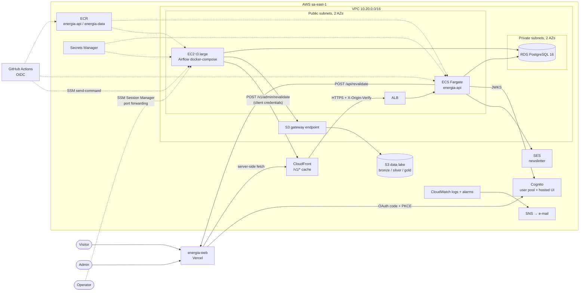

# energia-infra

Terraform for the AWS infrastructure (`sa-east-1`, single account, `prod` environment) of the
energy data platform. Phase 1: the public wind and solar curtailment monitor.

The contract between the repositories is in `energia-api/docs/phase1-contract.md`. This
repository creates the infrastructure; the database schema belongs to `energia-api` (Alembic)
and the pipeline to `energia-data`. The portal (`energia-web`) runs on **Vercel**, outside
Terraform.

## Architecture



### Decisions the contract did not fix

| Topic | Decision | Why |
|---|---|---|
| NAT gateway | **None.** Fargate tasks and the Airflow EC2 instance sit in public subnets with a public IP, but with no port open to the internet (tasks only accept the ALB security group; the EC2 instance accepts nothing). RDS sits in private subnets with no route to the internet. | A NAT costs a fixed hourly fee plus traffic, more than the whole API. |
| API origin | CloudFront → ALB. The ALB only accepts the CloudFront origin IPs (managed prefix list) and only forwards requests carrying the secret `X-Origin-Verify` header; everything else gets 403. | Prevents bypassing the cache and the CDN. |
| HTTPS | Two names: `api_domain` (CloudFront, ACM certificate in `us-east-1`) and `api_origin_domain` (ALB, ACM certificate in `sa-east-1`). Both are optional. | CloudFront validates the origin certificate by name; the `*.elb.amazonaws.com` name does not work. |
| No domain | When `api_origin_domain` is empty, CloudFront talks to the ALB over **plain HTTP**. `plan` shows a warning (`check` block) and the `warnings` output repeats it. Tests only. | The stack must plan without a domain. |
| Images | Mutable ECR tags: CI pushes `<sha>` and moves `latest`; the task definitions use `var.api_image_tag` (default `latest`). Deploy = migration + `update-service --force-new-deployment`. Rollback: pin a SHA in `api_image_tag` and apply. | Terraform keeps owning the task definitions (env, secrets) without drifting from CI. |
| Migration | The `energia-prod-api-migrate` task definition (same image) runs `alembic upgrade head` as the RDS **master user**. `DATABASE_URL` is built at run time from the RDS-managed secret (which RDS rotates), with the password URL-encoded. | The application users only exist after the first migration. |
| Application user passwords | Generated by Terraform (`random_password`) and stored in Secrets Manager; they are also in the state (encrypted private bucket). | Simplicity; the state is already treated as sensitive. |
| Cognito MFA | TOTP (authenticator app), no SMS. | No SNS/SMS cost or setup. |
| "tasks < 1" alarm | Container Insights enabled on the cluster (`RunningTaskCount` metric). | The metric does not exist without it; small cost. |
| CloudFront | `PriceClass_All`. | South American edges only exist in that class. |
| Apply in CI | Role with `AdministratorAccess`, but only assumable from the GitHub `production` environment (required reviewers). | Terraform creates IAM roles; restricting it further needs constant upkeep. |

## Modules

| Module | Creates |
|---|---|
| `bootstrap/` | State S3 bucket (versioned, SSE-S3, public access blocked, TLS only). Local state. |
| `modules/network` | VPC, 2 public and 2 private subnets in 2 AZs, internet gateway, route tables, S3 gateway endpoint, default SG without rules. |
| `modules/lake` | Data lake bucket: versioned, SSE-S3, public access blocked, TLS only; old versions expire after 90 days; `bronze/` moves to Intelligent-Tiering after 30 days. |
| `modules/ecr` | `energia-api` and `energia-data` repositories (scan on push, keeps the last 20 images). |
| `modules/database` | RDS PostgreSQL 16 (`db.t4g.micro`), encrypted, private, 7-day backups, deletion protection, TLS required, RDS-managed master password. Secrets `energia/prod/api/database` and `energia/prod/data/warehouse` with the application users' credentials. |
| `modules/api` | ALB, target group (`/health`), ECS cluster + Fargate service (0.25 vCPU / 0.5 GB), migration task definition, IAM roles, SGs, origin certificate (optional), `REVALIDATE_SECRET` secret. |
| `modules/cdn` | CloudFront distribution, cache policies (public and admin), certificate in `us-east-1` (optional). |
| `modules/auth` | Cognito: user pool (e-mail sign-in, mandatory MFA, only admins create users), `admin` group, hosted UI domain, `energia-api` resource server (`admin` scope), web client (code + PKCE, with a secret for Auth.js), machine client (client credentials, `energia-api/admin`). Secrets with both clients' credentials. |
| `modules/airflow` | Amazon Linux 2023 EC2 (`t3.large`, encrypted 40 GB gp3), no SSH and no inbound ports, access through SSM; IAM profile (lake, its own secrets, ECR pull, CloudWatch agent); `user_data` with Docker, Compose, the CloudWatch agent and the `.env` renderer; Airflow secret and SSM configuration parameter. |
| `modules/email` | SES domain identity with Easy DKIM (only when `ses_domain` is set). |
| `modules/observability` | API and Airflow log groups (30 days), SNS topic with an e-mail subscription, alarms (ALB 5xx, running tasks < 1, RDS CPU and disk, EC2 status check + auto-recover, failed Airflow tasks through a metric filter). |
| `modules/github_oidc` | GitHub OIDC provider and roles: `energia-prod-github-api`, `-data`, `-infra-plan`, `-infra-apply`. |

## Estimated monthly cost

> **Rough estimate, not a budget.** Orders of magnitude for `sa-east-1` (pricier than
> `us-east-1`), 24×7 usage and low traffic. **Check the
> [AWS Pricing Calculator](https://calculator.aws/) before deciding**; prices change and depend
> on usage.

| Component | Order of magnitude (US$/month) | Note |
|---|---|---|
| EC2 `t3.large` (Airflow) + 40 GB gp3 | ~90–120 | The largest item. Consider a Savings Plan or a smaller size after measuring. |
| RDS `db.t4g.micro` + 20 GB gp3 + backups | ~20–35 | Multi-AZ doubles the instance cost. |
| ALB | ~20–30 | Fixed hourly fee + LCUs. |
| Fargate 0.25 vCPU / 0.5 GB, 1 task | ~10–15 | |
| Public IPv4 (ALB in 2 AZs, task, EC2) | ~15–25 | AWS charges per hour for each public IPv4. |
| CloudFront | ~1–10 | Depends on traffic; the cache reduces ALB calls. |
| CloudWatch (logs, alarms, Container Insights) | ~5–15 | |
| Secrets Manager (~8 secrets) | ~3–5 | Charged per secret/month + calls. |
| S3 (lake + state) | ~1–5 | Depends on the bronze volume. |
| Cognito, SES, SNS, ECR | ~0–5 | Few admin users; M2M tokens and e-mails billed per use. |
| **Total** | **~170–270** | Without a NAT gateway (which would add ~40+ per month). |

## First deployment (runbook)

Requirements: Terraform ≥ 1.10, AWS CLI v2 with the
[Session Manager plugin](https://docs.aws.amazon.com/systems-manager/latest/userguide/session-manager-working-with-install-plugin.html),
`jq`, the `psql` 16 client and account administrator credentials (first deployment only; after
that CI assumes roles through OIDC).

### 1. State bucket

```bash
cd bootstrap
terraform init
terraform apply
terraform output -raw backend_hcl > ../envs/prod/backend.hcl
```

Keep `bootstrap/terraform.tfstate` somewhere safe (it is small and only describes the bucket).

### 2. Variables and certificates

```bash
cd envs/prod
cp terraform.tfvars.example terraform.tfvars
terraform init -backend-config=backend.hcl
```

Fill in `terraform.tfvars` before `init`. When `api_domain`/`api_origin_domain` are set, `apply`
waits for the ACM certificates to be validated through DNS. Create the certificates first and
publish the validation records:

```bash
terraform apply -target=module.cdn.aws_acm_certificate.api -target=module.api.aws_acm_certificate.origin
terraform output -json dns_records
```

The same records are also shown in the ACM console. Create the `_xxxx` CNAMEs at your DNS
provider (see [DNS records](#dns-records)).

### 3. Plan and apply

```bash
terraform plan -out=tfplan
terraform apply tfplan
```

After the apply, create the `api_domain → CloudFront` and `api_origin_domain → ALB` CNAMEs
(`dns_records` output). Confirm the SNS subscription in the `alarm_email` inbox.

### 4. API migration

It needs the `energia-api:latest` image in ECR (first push from the `energia-api` CI, or a
manual one).

```bash
terraform output -raw migration_command | bash
```

Equivalent to:

```bash
aws ecs run-task --region sa-east-1 \
  --cluster energia-prod \
  --task-definition energia-prod-api-migrate \
  --launch-type FARGATE \
  --network-configuration "awsvpcConfiguration={subnets=[subnet-a,subnet-b],securityGroups=[sg-tasks],assignPublicIp=ENABLED}"
```

Follow it in the `/energia/prod/api` log group (`migrate/` prefix).

### 5. Database users

After the first migration (the tables must exist):

```bash
./scripts/create-db-users.sh
```

The script reads the secrets with your credentials, opens an SSM port forward through the
Airflow EC2 instance to RDS (`localhost:15432`) and runs `scripts/create-db-users.sql` as the
master user. It creates:

- `energia_api`: `SELECT` on every table; `INSERT, UPDATE, DELETE` only on the tables the API
  writes: `monthly_report`, `newsletter_subscriber`, `organization`, `app_user` (the last two are
  not used by the code yet), `member`, `member_token`, `member_session` (sign-up, e-mail code,
  login) and `usage_event` (usage log). It also gets `USAGE` on every sequence. New tables become
  readable automatically (default privileges); writing to a new table must be granted in the SQL.
- `energia_data`: `SELECT, INSERT, UPDATE, DELETE` only on `plant`, `plant_monthly_curtailment`,
  `state_monthly_curtailment`, `subsystem_monthly_curtailment`, `hourly_curtailment` and
  `load_run` (contract, "How energia-data writes"), `USAGE` on the `load_run` sequence and the
  `TEMPORARY` privilege on the database, because every load is staged in a temporary table. It
  cannot even read the API tables (members, sessions, usage log).

The script is idempotent and convergent: it resets the write privileges of `energia_api` and every
privilege of `energia_data` before granting them, so a table removed from the list loses access
when the script is reapplied.

**Guard against drift.** The `database-permissions` job of the CI starts a Postgres 16, applies
the `energia-api` migrations (`main`), runs `create-db-users.sql` twice and then
`scripts/db-permissions/check.sh`: it connects as `energia_api` and as `energia_data`, writes,
updates and deletes a row in each table they own inside a transaction that is rolled back, and
checks that the forbidden tables are refused. It fails when a table appears that
`scripts/db-permissions/classify.sql` does not know, so a new migration cannot reach production
without a decision about who may write to it. The `plan` job waits for it. To run it locally
against any Postgres with the `energia-api` schema:
`PGHOST=... PGPORT=... PGDATABASE=... ADMIN_USER=... ADMIN_PASSWORD=... bash scripts/db-permissions/check.sh`.

Run it again after every `energia-api` release that adds a table: the commands are the same as the
first time (below). After it, the API starts (`DATABASE_URL` uses `energia_api`): if the
service was already retrying, force a deployment with
`aws ecs update-service --cluster energia-prod --service energia-prod-api --force-new-deployment`.

### 6. First Cognito admin

```bash
POOL=$(terraform output -json cognito | jq -r .user_pool_id)
aws cognito-idp admin-create-user --user-pool-id "$POOL" \
  --username admin@example.com \
  --user-attributes Name=email,Value=admin@example.com Name=email_verified,Value=true \
  --desired-delivery-mediums EMAIL
aws cognito-idp admin-add-user-to-group --user-pool-id "$POOL" \
  --username admin@example.com --group-name admin
```

The person gets a temporary password by e-mail and, on the first sign-in, changes it and sets up
the authenticator app (mandatory MFA).

### 7. Airflow (energia-data) on EC2

`user_data` installs Docker, Compose (v5.6.0, with checksum), git, jq and the CloudWatch agent,
creates `/opt/energia-data` (owned by `ec2-user`) and installs the `energia-render-env`
service, which on every boot writes `/opt/energia-data/.env` (mode 600) from Secrets Manager and
the `/energia/prod/data/config` SSM parameter:

| `.env` key | Source |
|---|---|
| `AWS_ACCOUNT_ID`, `LAKE_BUCKET`, `API_URL` | SSM parameter `/energia/prod/data/config` |
| `WAREHOUSE_DSN` | secret `energia/prod/data/warehouse` (`dsn`) |
| `COGNITO_TOKEN_URL`, `DATA_CLIENT_ID`, `DATA_CLIENT_SECRET`, `DATA_CLIENT_SCOPE` | secret `energia/prod/data/cognito-machine-client` |
| `AIRFLOW_FERNET_KEY`, `AIRFLOW_JWT_SECRET`, `AIRFLOW_ADMIN_USERNAME`, `AIRFLOW_ADMIN_PASSWORD` | secret `energia/prod/data/airflow` |
| `ENVIRONMENT=prod`, `AIRFLOW_UID=50000`, `AWS_REGION`, `AWS_DEFAULT_REGION` | fixed |

The instance role reads exactly these three secrets and this parameter. The lake uses the
instance profile (no static keys; IMDSv2 with hop limit 2 so the containers reach the
credentials). To rewrite `.env` without rebooting: `sudo /usr/local/bin/render-airflow-env.sh`.

**Repository clone (once).** `energia-data` is private: create a read-only *deploy key* on
GitHub and open a session on the instance. Register `~/.ssh/energia-data.pub` as the deploy key.
The directory already exists (with `.env` and `logs/`), so the clone happens in place:

```bash
aws ssm start-session --target $(terraform output -raw airflow_instance_id)
sudo su - ec2-user
ssh-keygen -t ed25519 -f ~/.ssh/energia-data -N ""
cat >> ~/.ssh/config <<'EOF'
Host github.com
  IdentityFile ~/.ssh/energia-data
EOF
cd /opt/energia-data
git init -b main
git remote add origin git@github.com:<org>/energia-data.git
git fetch origin main && git checkout -f -t origin/main
```

`.env` and `logs/` must be in the `energia-data` `.gitignore`.

**Deployment from the energia-data CI:**

```bash
aws ssm send-command --document-name AWS-RunShellScript \
  --targets "Key=InstanceIds,Values=$AIRFLOW_INSTANCE_ID" \
  --parameters 'commands=["cd /opt/energia-data && ./deploy.sh <sha>"]'
```

SSM runs the command as `root`; `.env` belongs to `ec2-user` with mode 600, readable by root.

`deploy.sh` (from `energia-data`) reads `.env` and runs
`docker compose -f docker-compose.yml -f docker-compose.prod.yml up -d`. Airflow must expose its
UI only on `127.0.0.1:8080` on the host and write task logs to `/opt/energia-data/logs`
(`./logs` in the compose file), from where the CloudWatch agent ships
`logs/dag_id=*/**/*.log` to the `/energia/prod/airflow` log group.

**Airflow UI** (SSM port forwarding only):

```bash
aws ssm start-session --region sa-east-1 --target <instance-id> \
  --document-name AWS-StartPortForwardingSession \
  --parameters portNumber=8080,localPortNumber=8080
```

Then open http://localhost:8080; the user and password are in the `energia/prod/data/airflow`
secret. The ready-made command is in the `airflow_port_forward_command` output.

### 8. GitHub

Create the `production` environment with **required reviewers** and a `main` branch rule in each
repository that deploys. The ARNs are in the `github_role_arns` output.

| Repository | Secrets | Variables |
|---|---|---|
| `energia-infra` | `AWS_PLAN_ROLE_ARN` (`infra_plan`), `AWS_APPLY_ROLE_ARN` (`infra_apply`, in the `production` environment) | `TF_BACKEND_HCL` (contents of `backend.hcl`), `TF_VARS` (contents of `terraform.tfvars`; keep secrets out of it) |
| `energia-api` | `AWS_ROLE_ARN` (`api`) | `AWS_REGION=sa-east-1`, `ECR_REPOSITORY=energia-api`, `ECS_CLUSTER`, `ECS_SERVICE`, `ECS_MIGRATION_TASK_DEFINITION`, `ECS_SUBNETS`, `ECS_SECURITY_GROUP` (`ecs` output) |
| `energia-data` | `AWS_ROLE_ARN` (`data`) | `AWS_REGION=sa-east-1`, `ECR_REPOSITORY=energia-data`, `AIRFLOW_INSTANCE_ID` |

The roles accept the `main` branch or the `production` environment (the token `sub` changes when
the job uses an environment). Expected API deployment flow: build → push `:<sha>` and `:latest`
→ `aws ecs run-task` for the migration and `aws ecs wait tasks-stopped` (check the exit code) →
`aws ecs update-service --force-new-deployment` → `aws ecs wait services-stable`.

If the account already has the GitHub OIDC provider, set `create_github_oidc_provider = false`.

### 9. Vercel (energia-web)

| Variable | Value |
|---|---|
| `API_URL` | `api_url` output |
| `REVALIDATE_SECRET` | secret `energia/prod/api/revalidate-secret` |
| `AUTH_COGNITO_ID` | `client_id` of the `energia/prod/web/cognito-web-client` secret |
| `AUTH_COGNITO_SECRET` | `client_secret` of the same secret |
| `AUTH_COGNITO_ISSUER` | `issuer` of the same secret (`https://cognito-idp.sa-east-1.amazonaws.com/<pool>`) |
| `AUTH_SECRET` | generate with `npx auth secret` (not stored on AWS) |

The `AUTH_*` names follow the Auth.js convention. The callback registered in Cognito
(`web_callback_urls`) must match the portal URL.

### 10. SES (newsletter)

With `ses_domain` set, publish the 3 DKIM CNAMEs (`dns_records` output). The account starts in
the SES **sandbox** (it only sends to verified addresses): request production access in *SES →
Account dashboard → Request production access* (manual, AWS answers within ~1 business day). SPF
and DMARC records on the domain are recommended. Pass the sender address to the API through
`api_extra_environment` as `EMAIL_SENDER`.

## DNS records

All of them at the domain's DNS provider (Terraform does not manage DNS). Exact values in
`terraform output -json dns_records`.

| Name | Type | Value | When |
|---|---|---|---|
| `_xxxx.api.<domain>` | CNAME | `_yyyy.acm-validations.aws.` | CloudFront certificate validation (`api_domain`) |
| `_xxxx.api-origin.<domain>` | CNAME | `_yyyy.acm-validations.aws.` | ALB certificate validation (`api_origin_domain`) |
| `api.<domain>` | CNAME | `dxxxx.cloudfront.net` | Public API |
| `api-origin.<domain>` | CNAME | `energia-prod-xxxx.sa-east-1.elb.amazonaws.com` | CloudFront origin (do not publicize) |
| `<token>._domainkey.<domain>` (×3) | CNAME | `<token>.dkim.amazonses.com` | SES DKIM |
| `<domain>` / `www` | A / CNAME | values given by Vercel | portal (set up in the Vercel dashboard) |

If the root domain is on Vercel DNS, create the records above there.

## Operations

- **Alarms** go to the `energia-prod-alerts` SNS topic. The Airflow task alarm counts the
  `Task failed with exception` (Airflow 3) and `Marking task as FAILED` (Airflow 2) lines in the
  task logs; attempts that will still be retried also count. Adjust `airflow_failure_pattern` in
  the `observability` module if the log format changes.
- **Changing `user_data`** (`airflow` module) makes the provider stop and start the instance to
  apply it; changing only the SSM configuration parameter does not touch the instance (run
  `render-airflow-env.sh` or reboot).
- **AMI**: the EC2 instance ignores new AMIs (`ignore_changes`); update with `dnf upgrade`
  through SSM or replace the instance on purpose.
- **RDS master password** is rotated by RDS; the migration task fetches the current value on
  every run.
- **Protected resources**: buckets (`prevent_destroy`), RDS (`deletion_protection`), EC2
  (`disable_api_termination`) and the user pool (`deletion_protection`).

## Development

```bash
terraform fmt -recursive -check
(cd bootstrap && terraform init -backend=false && terraform validate)
(cd envs/prod && terraform init -backend=false && terraform validate)
tflint --init && tflint --chdir=envs/prod --config="$PWD/.tflint.hcl"
trivy config --ignorefile .trivyignore.yaml .
```

## Pipeline

`.github/workflows/ci.yml` runs on every push, pull request and manual run:

| Job | What it does |
|---|---|
| Lint | `terraform fmt -check` and tflint (AWS ruleset) on `bootstrap` and `envs/prod` |
| Validate | `terraform validate` on `bootstrap` and `envs/prod` |
| Security scan | Trivy over the Terraform code (HIGH/CRITICAL) and a secret scan |
| Plan | `terraform plan` for `envs/prod`; on pull requests the plan is posted as a comment |
| Apply to production | On `main`, when the plan has changes: waits for approval in the `production` environment and applies exactly the reviewed plan file |

Plan and apply only run once the `TF_BACKEND_HCL` variable exists. Accepted Trivy findings live
in `.trivyignore.yaml`, each with the reason it is accepted.

Providers: `hashicorp/aws ~> 6.0` and `hashicorp/random ~> 3.0`; the exact versions (AWS
6.67.0, random 3.9.1) live in the `.terraform.lock.hcl` files, which are committed. To update:
`terraform init -upgrade` and
`terraform providers lock -platform=linux_amd64 -platform=windows_amd64 -platform=darwin_arm64 -platform=darwin_amd64`.
